# ARM-CLEAN05 — Diagramme entité–relation complet des DataAssets d’armes

> **ARM-CLEAN06 — NOUVELLE AUTORITÉ (13.11.2026).** [Modèle cible approuvé](ARM_CLEAN06_ITEM_SYSTEM_NORMATIVE.md) · [Migration](ARM_CLEAN06_MIGRATION_PLAN.md). **Audit ou jalon de l'ancien modèle ; ne constitue plus l'architecture cible.** **Cible non encore implémentée ; aucun legacy dans le runtime final.**

**Révision :** `master` au SHA `8a73ebaf106add5ace9fff775c2e49c7ef7582dc`, 13 novembre 2026. **Statut :** modèle constaté / anomalies non corrigées.

> Une flèche ER matérialise une relation **possible dans le schéma C++**, pas la preuve que chaque référence est renseignée dans chaque `.uasset` binaire. `FGrid*` et `WBP_*` sont inclus pour montrer les jointures et circuits d’icônes, mais ne sont pas des DataAssets indépendants. Les relations par `FName` ne sont pas des pointeurs UObject.

## 1. Diagramme ER — architecture actuellement codée

```mermaid
erDiagram
    ITEM_DEFINITION {
        string class_UGridItemDefinitionAsset
        FName ItemDefinitionId PK
        FName WeaponArchetypeId FK
        softptr WeaponCatalogue FK
        softptr WeaponVisualCatalogue FK
        FName RequiredAmmunitionItemDefinitionId FK
        FText DisplayName
        float Weight
        texture Icon
        mesh WorldMesh
        mesh EquippedMesh
        bool bUseWeaponCatalogue
        bool bUseWeaponVisualCatalogue
    }
    WEAPON_CATALOGUE {
        string asset_DA_WeaponCatalogue
        array ArchetypeProgressions
        array Profiles_legacy
        array ClassAffinities
        array ClassPreferences
    }
    ARCHETYPE_KEY {
        FName ArchetypeId PK
        string ARM001_to_ARM082
    }
    COMPACT_PROGRESSION {
        FName BaseProfile_ArchetypeId FK
        struct BaseProfile_N1
        array FiveGrowthRules
    }
    LEVEL_PROFILE {
        int ItemLevel
        FText DisplayName
        float WeightKg
        int ActionPointCost
        int RangeCells
        int PhysicalArmor
        int MagicalArmor
        struct DamageDice
    }
    GROWTH_RULE {
        int StepEveryLevels
        int StepAmount
        array Exceptions
    }
    GROWTH_EXCEPTION {
        int ItemLevel
        int Value
    }
    CLASS_AFFINITY {
        FName ArchetypeId FK
        FName PrimaryClassId
        array SecondaryClassIds
    }
    CLASS_PREFERENCE {
        FName ClassId
        string PriorityWeapons
        string Synergies
    }
    VISUAL_CATALOGUE {
        string asset_DA_WeaponVisualCatalogue
        array ArchetypeBindings
        array VisualProfiles
    }
    VISUAL_BINDING {
        FName ArchetypeId FK
        FName VisualId FK
    }
    VISUAL_PROFILE {
        FName VisualId PK
        FName FamilyTag
        texture BaseIcon
        mesh WorldMesh
        mesh EquippedMesh
        mesh OrnamentMesh
        transform WorldVisualTransform
        transform OrnamentRelativeTransform
    }
    COMBAT_ACTION {
        FName ActionId PK
        FText DisplayName
        texture Icon
        int ActionPointCost
        int RangeCells
        FName PresentationProfileId
        struct OffensiveProfile
        struct ResourceCosts
    }
    OFFENSIVE_PROFILE {
        FName AttackId
        struct AttackDefinition_N1
        int FlatDamageBonus
        int RangeCells
    }
    ATTACK_PRESENTATION {
        string embedded_PlayerAttackPresentationProfile
        enum MotionStyle
        float MotionDurationSeconds
        struct AttackAudio
        struct ImpactHitAudio
        struct ImpactMissAudio
        struct AttackVFX
        struct ImpactHitVFX
        struct ImpactMissVFX
    }
    AUDIO_CHANNEL {
        array Sounds
        float VolumeMultiplier
        float PitchMin
        float PitchMax
    }
    NIAGARA_CHANNEL {
        array Systems
        bool bAttachToHeldItem
        FName SocketName
        transform EffectPlacement
    }
    ITEM_EFFECTS {
        struct LightEmitter
        array VisualEffects
        struct WorldSparkle
    }
    ACTION_ICON_PALETTE {
        string asset_DA_EquippedWeaponActionIcons
        map Kind_to_Texture2D
    }
    ACTION_ICON_KIND {
        enum EGridEquippedWeaponActionIconKind PK
        texture Icon
    }
    HOTBAR_WIDGET {
        string class_WBP_GridCombatHudAction
        object EquippedWeaponActionIconPalette
        texture DualAttackIcon_legacy
    }
    ITEM_INSTANCE {
        guid RuntimeObjectId PK
        FName ItemDefinitionId FK
        int ItemLevel
        FText DisplayName_snapshot
        float Weight_snapshot
        int Quantity
    }
    OBJECT_PALETTE {
        string asset_DA_ObjectPalette_Default
        array Entries
    }
    OBJECT_PALETTE_ENTRY {
        FName EntryId
        object DefaultItemDefinition FK
    }
    LEVEL_DATA_ASSET {
        string asset_DA_GridLevel_xx
        array LooseItems
    }
    LOOSE_ITEM {
        object ItemDefinition FK
        int ItemLevel
        int Quantity
    }
    AMMUNITION_DEFINITION {
        string asset_DA_Item_Arrows_01
        FName ItemDefinitionId PK
    }
    TEXTURE2D {
        string asset_Texture2D
    }
    STATIC_MESH {
        string asset_StaticMesh
    }
    SOUND_ASSET {
        string asset_SoundBase
    }
    NIAGARA_ASSET {
        string asset_NiagaraSystem
    }

    ITEM_DEFINITION }o--o| WEAPON_CATALOGUE : "WeaponCatalogue soft reference"
    ITEM_DEFINITION }o--o| VISUAL_CATALOGUE : "WeaponVisualCatalogue soft reference UNIQUE"
    ITEM_DEFINITION }o--o| ARCHETYPE_KEY : "WeaponArchetypeId value"
    WEAPON_CATALOGUE ||--|{ COMPACT_PROGRESSION : "ArchetypeProgressions 82"
    COMPACT_PROGRESSION ||--|| LEVEL_PROFILE : "BaseProfile N1"
    COMPACT_PROGRESSION ||--|{ GROWTH_RULE : "5 rules"
    GROWTH_RULE ||--o{ GROWTH_EXCEPTION : "Exceptions"
    COMPACT_PROGRESSION }o--|| ARCHETYPE_KEY : "BaseProfile.ArchetypeId"
    WEAPON_CATALOGUE ||--o{ CLASS_AFFINITY : "ClassAffinities 82"
    WEAPON_CATALOGUE ||--o{ CLASS_PREFERENCE : "ClassPreferences 6"
    CLASS_AFFINITY }o--|| ARCHETYPE_KEY : "ArchetypeId"
    VISUAL_CATALOGUE ||--o{ VISUAL_BINDING : "ArchetypeBindings"
    VISUAL_CATALOGUE ||--o{ VISUAL_PROFILE : "VisualProfiles"
    VISUAL_BINDING }o--|| ARCHETYPE_KEY : "ArchetypeId"
    VISUAL_BINDING }o--|| VISUAL_PROFILE : "VisualId"
    ITEM_DEFINITION ||--o{ COMBAT_ACTION : "CombatActions embedded"
    COMBAT_ACTION ||--o| OFFENSIVE_PROFILE : "OffensiveProfile embedded"
    ITEM_DEFINITION ||--o| ATTACK_PRESENTATION : "PlayerAttackPresentationProfile"
    ATTACK_PRESENTATION ||--|{ AUDIO_CHANNEL : "Attack Hit Miss"
    ATTACK_PRESENTATION ||--|{ NIAGARA_CHANNEL : "Attack Hit Miss"
    ITEM_DEFINITION ||--o| ITEM_EFFECTS : "light sparkle persistent FX"
    ACTION_ICON_PALETTE ||--o{ ACTION_ICON_KIND : "Icons map"
    HOTBAR_WIDGET }o--o| ACTION_ICON_PALETTE : "EquippedWeaponActionIconPalette"
    HOTBAR_WIDGET ||--o{ COMBAT_ACTION : "shows resolved actions"
    ACTION_ICON_KIND }o--o| TEXTURE2D : "action icon"
    VISUAL_PROFILE }o--o| TEXTURE2D : "BaseIcon item icon"
    VISUAL_PROFILE }o--o{ STATIC_MESH : "World Equipped Ornament"
    ITEM_DEFINITION }o--o| TEXTURE2D : "Icon legacy fallback"
    COMBAT_ACTION }o--o| TEXTURE2D : "Icon action fallback"
    ITEM_DEFINITION }o--o{ STATIC_MESH : "WorldMesh EquippedMesh legacy"
    AUDIO_CHANNEL }o--o{ SOUND_ASSET : "Sounds"
    NIAGARA_CHANNEL }o--o{ NIAGARA_ASSET : "Systems"
    ITEM_INSTANCE }o--|| ITEM_DEFINITION : "ItemDefinitionId saved"
    OBJECT_PALETTE ||--o{ OBJECT_PALETTE_ENTRY : "Entries"
    OBJECT_PALETTE_ENTRY }o--o| ITEM_DEFINITION : "DefaultItemDefinition direct ref"
    LEVEL_DATA_ASSET ||--o{ LOOSE_ITEM : "LooseItems"
    LOOSE_ITEM }o--o| ITEM_DEFINITION : "ItemDefinition direct ref"
    ITEM_DEFINITION }o--o| AMMUNITION_DEFINITION : "ammo ID only"
```

### Attention : catégories et nature des liens

| Type de lien | Précision |
|---|---|
| `WeaponCatalogue` / `WeaponVisualCatalogue` | **Deux références soft différentes**, chacune vers son propre catalogue ; une seule propriété C++ `WeaponVisualCatalogue` est déclarée dans `UGridItemDefinitionAsset`. |
| `WeaponArchetypeId` → `ArchetypeId` | Jointure **par valeur `FName`** entre la définition, la progression ARMxxx et le binding visuel ; pas trois pointeurs d’asset. |
| `VisualId` | Jointure `ArchetypeBindings[].VisualId` vers `VisualProfiles[].VisualId` ; plusieurs archétypes peuvent partager un même profil visuel. |
| `CombatActions`, `OffensiveProfile`, `PlayerAttackPresentationProfile`, `Audio/VFX`, `ItemEffects` | **USTRUCT imbriqués**, ils ne correspondent pas à de nouveaux fichiers `.uasset` sauf les textures, sons et Niagara qu’ils référencent. |
| `DA_EquippedWeaponActionIcons` | **Autre DataAsset**, référencé dans les réglages du `WBP_GridCombatHudAction` et **non directement** depuis chaque `DA_Weapon_*`. Contient la map catégorie d’action → icône. |
| `DA_ObjectPalette_Default`, niveaux | **Consommateurs inverses** : leurs entrées/placements peuvent référencer directement des `UGridItemDefinitionAsset` d’armes ; tous les emplacements ne sont pas nécessairement renseignés. |
| `DA_Item_Arrows_01` | Lien logique `RequiredAmmunitionItemDefinitionId = Item_Arrows_01` pour les armes qui l’exigent ; **ce n’est pas un pointeur vers le DataAsset**. |
| `ITEM_INSTANCE` | Structure sauvegardée / runtime `FGridItemInstance`, **pas un DataAsset** ; stocke notamment `ItemLevel`, nom et poids d’instance. |

## 2. Les trois sources d’icônes actuelles — problème de priorité

1. **Icône d’objet** : `DA_WeaponVisualCatalogue.VisualProfiles[].BaseIcon` → `FGridWeaponVisualResolver` ; `UGridItemDefinitionAsset.Icon` est le fallback legacy direct. Elle représente l’arme dans le sac, l’objet au sol ou l’aperçu.
2. **Icône de commande** : `DA_EquippedWeaponActionIcons.Icons[EGridEquippedWeaponActionIconKind]`, lue par le widget de combat ; le type est calculé par `FGridEquippedWeaponActionIconResolver::Classify` à partir de l’action et de l’archétype. **Ce n’est pas une copie du catalogue de meshes.**
3. **Icône éditable de chaque action** : `CombatActions[i].Icon`, parfois copiée de `BaseIcon` dans `GridWeaponPipelineCommandlet`, puis potentiellement réécrite par `FGridWeaponVisualUiResolver::ApplyCatalogueIcon`. Le rendu HUD préfère la palette d’actions lorsqu’une catégorie disponible possède une icône, puis replie sur `Action.Icon` ; ceci crée une priorité à plusieurs étages peu lisible.

**Conclusion** : une même texture peut être écrite dans `VisualProfiles[].BaseIcon`, `UGridItemDefinitionAsset.Icon` et `CombatActions[i].Icon`, pendant qu’une quatrième icône (distincte) peut s’afficher via `DA_EquippedWeaponActionIcons`. Ce n’est pas une seule relation et cela ne devrait pas être exposé comme quatre choix équivalents dans `DA_Weapon_xxx`.

## 3. Vérification du nom `DA_VisualCatalogue` et de la « double référence »

- **Nom `DA_VisualCatalogue`** : absent de l’arborescence **versionnée** à ce SHA et des recherches textuelles du dépôt. Ce nom peut correspondre à un asset local non commité, à un renommage, ou à un usage informel. Je ne lui invente ni classe ni relation dans le graphe.
- **`DA_WeaponVisualCatalogue` référencé deux fois dans votre fiche** : le header `GridItemDefinitionAsset.h` n’expose qu’un `TSoftObjectPtr<UGridWeaponVisualCatalogueAsset> WeaponVisualCatalogue` (ligne 162) et un booléen `bUseWeaponVisualCatalogue` (ligne 158). **Le code permet d’affirmer une propriété directe, pas deux.** Les fichiers `.uasset` étant suivis par Git LFS, cette inspection statique ne prouve pas ce que votre panneau Details affiche réellement. Une vérification sérialisée dans Unreal est nécessaire pour qualifier et dédupliquer le second affichage/référencement constaté.
- Une ligne vers `DA_WeaponVisualCatalogue` **et** une ligne vers `DA_WeaponCatalogue` sont deux relations légitimes **de types différents** ; deux références vers le **même** `DA_WeaponVisualCatalogue` dans la même fiche ne sont pas justifiées par le header actuel.

## 4. Inventaire physique des DataAssets d’armes versionnés

Le répertoire `Content/GrimrockPrototype/Core/DataAssets/Weapons/` contient **26 `.uasset`** : **24 définitions `DA_Weapon_*`** et les **deux catalogues** `DA_WeaponCatalogue`, `DA_WeaponVisualCatalogue`. Voici les 24 définitions, toutes couvertes par l’entité `ITEM_DEFINITION` :

| Groupe | Fichiers présents (préfixe `DA_Weapon_`, extension `.uasset` omise) |
|---|---|
| Lames et armes blanches | AssassinDagger_01, Dagger_01, GreatAxe_01, LongSword_01, Mace_01, MainGauche_01, ShortSpear_01, Stiletto_01, StraightSword_01, WarPick_01 |
| Distance et jet | Dart_01, Javelin_01, RecurveBow_01, ShortBow_01, Shuriken, ThrowingKnife, ThrowingKnife_01 |
| Magie et focus | ArcaneOrb_01, ArcaneWand_01, ElementalStaff_01, FireWand_01, HolyScepter_01 |
| Boucliers | HolyAegis_01, RoundShield_01 |

`DA_Weapon_ThrowingKnife` et `DA_Weapon_ThrowingKnife_01` **coexistent physiquement** : leur présence ne signifie pas que les deux soient tous deux utilisés. `DA_Weapon_Shuriken` est également une ancienne définition spécifique ; ne pas effacer sans vérifier les niveaux et sauvegardes qui la référencent.

**Autres DataAssets en relation réelle ou potentielle (mais hors du répertoire `Weapons/`)** :
- `Content/GrimrockPrototype/UI/Icons/Combat/DA_EquippedWeaponActionIcons.uasset` : palette des commandes d’armes.
- `Content/GrimrockPrototype/Core/DataAssets/DA_ObjectPalette_Default.uasset` : palette d’édition avec champ `DefaultItemDefinition` dans ses entrées.
- `Content/GrimrockPrototype/Core/DataAssets/Items/DA_Item_Arrows_01.uasset` : définition de munitions reliée par ID.
- `Content/GrimrockPrototype/Core/DataAssets/GrimrockLevels/DA_GridLevel_00.uasset`, `_01`, `_New_Level_03`, `_Pillars_of_Light` : assets de niveau capables de contenir des `FGridLooseItemInstance` avec une référence vers une définition d’arme.

Les Texture2D, StaticMesh, SoundBase et NiagaraSystem dessinés dans le diagramme sont des **assets de ressources**, pas des DataAssets d’armes supplémentaires.

## 5. Sources C++ faisant foi

- `Source/GrimrockPrototype/Public/Runtime/GridItemDefinitionAsset.h` : définition, référentiels, actions, audio/VFX et fallback.
- `Source/GrimrockPrototype/Public/Runtime/Combat/GridWeaponCatalogueAsset.h` : 82 progressions compactes, N1 et cinq règles, affinités.
- `Source/GrimrockPrototype/Public/Runtime/Combat/GridWeaponVisualCatalogueAsset.h` : bindings ARMxxx/VisualId, profils icône/meshes.
- `Source/GrimrockPrototype/Public/UI/GridEquippedWeaponActionIconPalette.h` : palette d’icônes de combat.
- `Source/GrimrockPrototype/Public/UI/GridCombatHudWidget.h` et `Private/UI/GridCombatHudWidget.cpp` : référence WBP et ordre d’affichage.
- `Source/GrimrockPrototype/Private/UI/GridWeaponVisualUiResolver.cpp` et `Private/Runtime/Combat/GridWeaponVisualResolver.cpp` : projection des icônes et fallback.
- `Source/GrimrockPrototypeEditor/Private/ARMEMENT/GridWeaponPipelineCommandlet.cpp` : copies de nom, poids, icônes et meshes lors de la création des armes.
- `Source/GrimrockPrototype/Public/Core/GridObjectPaletteAsset.h` et `GridLevelPlacementTypes.h` : placements d’objets et liens inverses.

## 6. Anomalies à résoudre avant de modifier les DataAssets

- `DisplayName`, `Weight`, `Icon`, `WorldMesh` et `EquippedMesh` existent dans deux autorités et sont parfois recopiés une troisième fois dans l’action.
- `WeaponCatalogue` et `WeaponVisualCatalogue` sont répétés par **référence** dans chacun des 24 DataAssets plutôt que résolus depuis une configuration centrale.
- `bUseWeaponCatalogue` et `bUseWeaponVisualCatalogue` maintiennent deux modes runtime parallèles et leurs fallbacks.
- `PresentationProfileId` n’est pas la clé de sélection du lecteur actuel `UGridPlayerAttackPresentationComponent::ResolveProfile`, qui utilise l’ItemDefinitionId et le profil de présentation directement embarqué sur la fiche.
- Le second affichage ou référencement de `DA_WeaponVisualCatalogue` signalé dans l’éditeur reste **une anomalie à confirmer avec un audit de sérialisation UE**, non résoluble par la seule lecture des headers C++.

**Décision** : ce diagramme est un **état des lieux**, pas l’architecture cible ; il ne légitime aucun des doublons ni une suppression immédiate des UPROPERTY.
