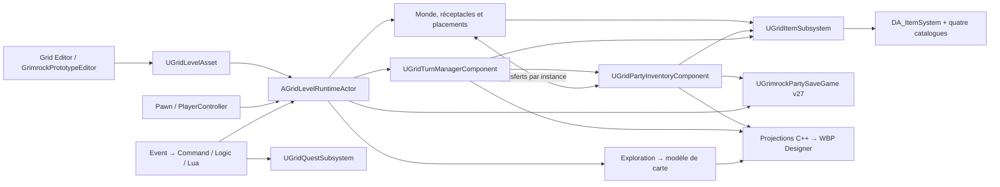

# Carte Mermaid du prototype

[Responsabilités](GRIMROCK_PROJECT_MAP.md) · [modèle relationnel détaillé](../DataModel.md).

La flèche vers Save représente la capture d’état. Le champ durable des quêtes existe et le raccordement Pawn de sa capture reste suspendu dans [MON21.4](../../Design/PROJECT_COMPLETION_ROADMAP.md). La [carte historique détaillée](https://github.com/PhilippeMartin1964/GrimrockPrototype/blob/2941d211ded3ffca873065d93eb05a9a2c51c7b3/docs/Architecture/Maps/GRIMROCK_PROJECT_MAP_MERMAID.md) décrit les vues par domaine au checkpoint DOC-ARCH01.
